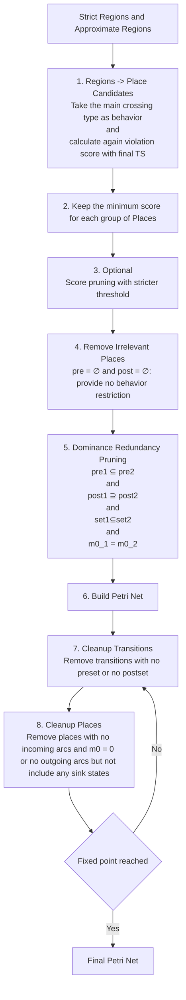

# Region → Petri Net Pipeline (Strict + Approximate Regions)

This pipeline describes the full transformation from state-based regions to a cleaned Petri net, including place selection and structural cleanup.

---

## Overview

